<!-- ============================== -->

<!--       RITVIK MUDGAL            -->

<!--      Developer Laboratory      -->

<!-- ============================== -->

<div align="center">

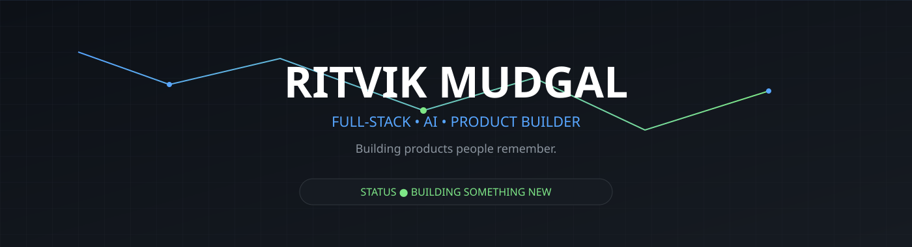

<br><br>


<br>

<p>

<a href="https://github.com/ritvikmudgal?tab=repositories">

</a>

<a href="#">

</a>

<a href="#">

</a>

<a href="mailto:YOUR_EMAIL">

</a>

</p>

</div>

---

# > boot.log

```text
████████████████████████████████████████ 100%

✓ Loading repositories

✓ Initializing experiments

✓ Connecting AI modules

✓ Rendering interfaces

✓ Deploying curiosity

STATUS : ONLINE
```

---

# Welcome.

I'm **Ritvik Mudgal**.

I enjoy building software that people actually **remember using**.

Most of my projects sit somewhere between

> AI × Beautiful UI × Useful Products

You'll usually find me building:

* 🧠 AI-powered tools
* 🌐 Full-stack web applications
* ⚡ Developer utilities
* 🎨 Modern interfaces
* 🚀 Random ideas that somehow become products


<!-- ===================================================== -->
<!--                 MISSION CONTROL                        -->
<!-- ===================================================== -->

<h2 align="center">
🛰️ MISSION CONTROL
</h2>

<table align="center">
<tr>

<td width="50%">

### System Status

```text
Developer         : Ritvik Mudgal

Mode              : BUILDING

Current Mission   : Ship memorable products

Primary Stack     : AI × Full Stack

Coffee            : ███░░░░░░░ 32%

Sleep             : UNKNOWN

Bugs Fixed        : Loading...

Ideas             : ∞

Status            : ONLINE 🟢
```

</td>

<td width="50%">


</td>

</tr>
</table>

---

# 🧪 FEATURED EXPERIMENTS

<table>

<tr>

<td width="50%">

## 🌌 Vent-It-Out

Anonymous social platform built around handwritten letters instead of timelines.

### Highlights

- ✉️ Anonymous sharing
- 🎨 Beautiful letter aesthetic
- 📌 Pinterest-style discovery
- 🔐 Google Authentication
- ⚡ Express + MongoDB
- 📱 Responsive UI

<a href="https://github.com/ritvikmudgal">

</a>

</td>

<td width="50%">

## ⌨️ AI Typing Stats

Python productivity tool that analyzes how developers actually type.

### Features

- Live WPM
- AI comparison
- Focus score
- Paste detection
- Session analytics
- 697+ downloads

<a href="https://github.com/ritvikmudgal">

</a>

</td>

</tr>

<tr>

<td width="50%">

## 🧠 Resume Judger

AI-powered resume evaluator with ATS scoring and detailed improvement suggestions.

### Features

- ATS Score
- AI Feedback
- Resume Review
- Better Suggestions
- LLM Powered

<a href="https://github.com/ritvikmudgal">

</a>

</td>

<td width="50%">

## 🚀 AescapicLab

Building premium websites and AI experiences for businesses.

### Focus

- Modern UI
- Fast websites
- AI Integration
- Business Automation
- Product-first Design

<a href="https://github.com/ritvikmudgal">

</a>

</td>

</tr>

</table>

---

<h2 align="center">

⚡ CURRENTLY BUILDING

</h2>

```text
██████████████████████████████████████

> Building AI-powered developer tools

> Shipping beautiful interfaces

> Learning deeper system design

> Exploring automation & intelligent workflows

██████████████████████████████████████
```

---

# 🛠 WORKBENCH

Instead of a boring skill list...

Everything currently sitting on my workbench.

<p align="center">


</p>

---

# Philosophy

> Great software isn't remembered because it had the most features.

> It's remembered because people wanted to come back and use it again.

---


<!-- ===================================================== -->

<!--                     AI LAB                            -->

<!-- ===================================================== -->

<h2 align="center">

🧠 AI LAB

</h2>

<p align="center">

<i>
Where ideas become prototypes,
and prototypes slowly become products.
</i>

</p>

<br>

<table>

<tr>

<td width="50%">

### Current Experiments

```text
[███████████████░░░] Resume Intelligence

[█████████████░░░░] AI Developer Tools

[███████████░░░░░░] Smart Web Experiences

[████████████████░] Prompt Engineering

[████████████░░░░░] Automation Systems
```

</td>

<td width="50%">

### Currently Exploring

* 🤖 LLM Applications

* 🧠 AI-assisted Workflows

* ⚡ Automation

* 🎨 Better User Experience

* 🌍 Useful Products

</td>

</tr>

</table>

<br>

<p align="center">

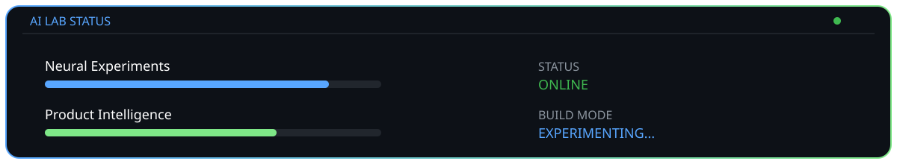

</p>

---

<h2 align="center">

⚙ DEVELOPMENT PHILOSOPHY

</h2>

<table>

<tr>

<td>

Instead of building projects just to fill a portfolio,
I enjoy creating products that solve real problems
while also feeling polished and enjoyable to use.

Whether it's an anonymous social platform,
an AI-powered resume reviewer,
or a typing analytics tool,
I like combining thoughtful design with practical functionality.

</td>

</tr>

</table>

---


<!-- ===================================================== -->

<!--                   BUILD TIMELINE                       -->

<!-- ===================================================== -->

<h2 align="center">

📜 BUILD LOG

</h2>

<p align="center">

Every project leaves behind a better developer than the one who started it.

</p>

<br>

<p align="center">

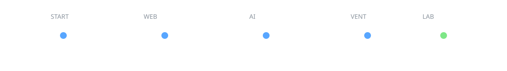

</p>

<br>

<table>

<tr>

<td width="20%" align="center">

### 🌱

Started Learning

HTML • CSS • JavaScript

</td>

<td width="20%" align="center">

### 💻

First Websites

Responsive UI

Frontend Projects

</td>

<td width="20%" align="center">

### 🧠

AI Journey

Resume Judger

Developer Tools

</td>

<td width="20%" align="center">

### 🌌

Vent-It-Out

Anonymous Platform

Beautiful UI

</td>

<td width="20%" align="center">

### 🚀

AescapicLab

Building Premium Products

</td>

</tr>

</table>

---

<h2 align="center">

🏆 PROJECT MILESTONES

</h2>

<table>

<tr>

<td width="50%">

### 🌌 Vent-It-Out

✔ Designed from scratch

✔ Full-stack architecture

✔ Authentication

✔ Responsive UI

✔ Modern animations

</td>

<td width="50%">

### ⌨ AI Typing Stats

✔ Python

✔ Productivity analytics

✔ Focus score

✔ 697+ downloads

✔ Developer utility

</td>

</tr>

<tr>

<td width="50%">

### 🧠 Resume Judger

✔ AI evaluation

✔ ATS scoring

✔ Prompt engineering

✔ Better feedback

</td>

<td width="50%">

### 🚀 AescapicLab

✔ Business identity

✔ Premium web design

✔ Product-first approach

✔ Growing portfolio

</td>

</tr>

</table>

---


<!-- ===================================================== -->

<!--                 DEVELOPER CABINET                     -->

<!-- ===================================================== -->

<h2 align="center">

🗄️ OPEN THE CABINET

</h2>

<p align="center">

Every shelf contains something I'm actively building, learning, or experimenting with.

</p>

<br>

<table>

<tr>

<td width="50%">

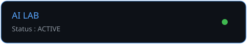

### 🧠 AI Experiments

Building practical AI tools rather than AI demos.

Current interests:

* Resume Intelligence
* Prompt Engineering
* AI-assisted Development
* Automation
* LLM Workflows

</td>

<td width="50%">

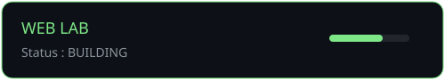

### 🌐 Web Experiences

I enjoy building websites that feel like products.

Current stack:

* React
* Next.js
* Tailwind CSS
* Node.js
* MongoDB
* Framer Motion

</td>

</tr>

<tr>

<td width="50%">

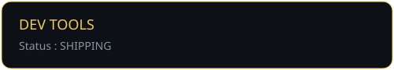

### ⚡ Developer Tools

Small tools that improve productivity.

Projects include:

* AI Typing Stats
* Resume Judger
* Developer Utilities
* Automation Scripts

</td>

<td width="50%">

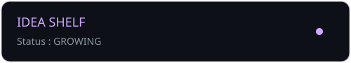

### 💡 Idea Shelf

Things currently living in my notebook.

* AI Interview Platform
* Better Portfolio Systems
* Productivity Apps
* Startup Experiments

</td>

</tr>

</table>

---

<h2 align="center">

📡 LIVE DASHBOARD

</h2>

<p align="center">


</p>

---


<!-- ===================================================== -->
<!--                     ARSENAL                           -->
<!-- ===================================================== -->

<h2 align="center">

⚔️ ARSENAL

</h2>

<p align="center">

The technologies I reach for when turning ideas into products.

</p>

<br>

<table>

<tr>

<td width="25%" align="center">

### Frontend

React

Next.js

Vite

Tailwind CSS

Framer Motion

HTML5

CSS3

JavaScript

TypeScript

</td>

<td width="25%" align="center">

### Backend

Node.js

Express.js

REST APIs

JWT

Google OAuth

Cookies

Sessions

Multer

</td>

<td width="25%" align="center">

### Data

MongoDB

Mongoose

MySQL

Atlas

</td>

<td width="25%" align="center">

### AI & Tools

Python

OpenAI

Gemini

Git

GitHub

Postman

VS Code

Vercel

Render

</td>

</tr>

</table>

<br>

<p align="center">

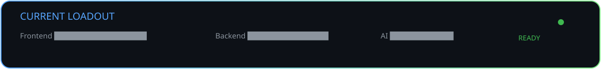

</p>

---

### Currently mastering

```text
██████████████████████████████████

✓ AI Products

✓ Modern UI

✓ Full Stack Architecture

──────────────

Learning

• System Design

• Advanced DSA

• Scalable Backend Design

██████████████████████████████████
```


<!-- ===================================================== -->

<!--                  DEVELOPER DNA                        -->

<!-- ===================================================== -->

<h2 align="center">

🧬 DEVELOPER DNA

</h2>

<p align="center">

<i>The habits, principles, and mindset behind everything I build.</i>

</p>

<br>

<p align="center">

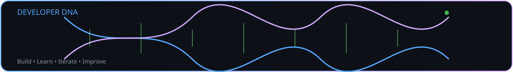

</p>

<br>

<table>

<tr>

<td width="50%">

### 🧠 Engineering Mindset

```text
▣ Build before overthinking

▣ Design with purpose

▣ Learn by shipping

▣ Curiosity over comfort

▣ Products over tutorials

▣ Simplicity scales
```

</td>

<td width="50%">

### 🎯 What I Optimize For

```text
✓ Clean architecture

✓ Memorable UI

✓ Practical AI

✓ Performance

✓ User experience

✓ Continuous learning
```

</td>

</tr>

</table>

---

### My approach

> I enjoy turning ideas into polished products, not just completing projects.

> I believe great software should feel intuitive, look intentional, and solve a real problem.

> If I don't know something yet, I learn it by building with it.

---

<table>

<tr>

<td align="center" width="33%">

### 🚀 Build

Prototype first.

Refine later.

</td>

<td align="center" width="33%">

### 🔬 Learn

Every project should teach me something new.

</td>

<td align="center" width="33%">

### ✨ Polish

The last 10% of the UI often creates 90% of the experience.

</td>

</tr>

</table>

---


<!-- ===================================================== -->

<!--                 BEYOND THE CODE                       -->

<!-- ===================================================== -->

<h2 align="center">

🌍 BEYOND THE CODE

</h2>

<p align="center">

The person behind the repositories.

</p>

<br>

<table>

<tr>

<td width="50%">

### Currently

```text
📍 Based in India

🎓 Computer Science Student

🚀 Building AescapicLab

🌱 Learning Japanese (N5)

🧠 Exploring AI Systems

💡 Always chasing the next idea
```

</td>

<td width="50%">

### Outside Coding

```text
• Building products

• UI & UX exploration

• Startup ideas

• Open Source

• Learning by building

• Turning curiosity into software
```

</td>

</tr>

</table>

---

### What keeps me building?

I enjoy solving problems that sit at the intersection of **technology**, **design**, and **real user needs**.

Whether it's an AI-powered tool, a polished web experience, or a simple developer utility, my goal is always the same:

> Build something useful enough that people genuinely enjoy coming back to it.

<br>

<table>

<tr>

<td align="center">

🧠

### Curiosity

Every new technology is an excuse to build something with it.

</td>

<td align="center">

⚡

### Momentum

Small improvements every day eventually become products.

</td>

<td align="center">

🚀

### Ambition

Always aiming to create software that leaves an impression.

</td>

</tr>

</table>

---

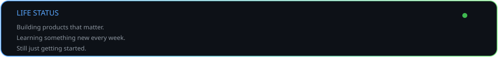

---


<!-- ===================================================== -->

<!--                  DEVELOPER PULSE                      -->

<!-- ===================================================== -->

<h2 align="center">

📊 DEVELOPER PULSE

</h2>

<p align="center">

<i>Real-time signals from my GitHub journey.</i>

</p>

<br>

<p align="center">

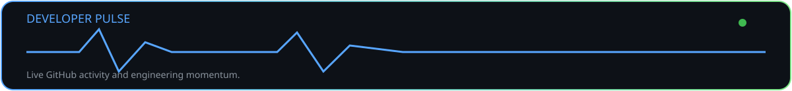

</p>

<br>

<div align="center">


</div>

<br>

<div align="center">


</div>

<br>

<div align="center">


</div>

---

### Snapshot

<table>

<tr>

<td align="center">

🚀

### Building

AI-first products with modern web technologies.

</td>

<td align="center">

⚡

### Shipping

Projects that focus on usability before complexity.

</td>

<td align="center">

📚

### Growing

Learning through real-world experiments, not just tutorials.

</td>

</tr>

</table>

---


<!-- ===================================================== -->

<!--                  A NOTE FROM ME                       -->

<!-- ===================================================== -->

<h2 align="center">

✍️ A NOTE FROM ME

</h2>

<p align="center">

<i>Why I build.</i>

</p>

<br>

> I don't build projects just to fill a portfolio.
>
> I build because I enjoy turning ideas into products that people actually remember using.
>
> Every repository here started with curiosity—sometimes to solve a problem, sometimes just to learn something I didn't know yesterday.
>
> I'm especially interested in the intersection of **AI**, **great user experiences**, and **developer tools**.
>
> My goal isn't to know every framework.
>
> It's to become the kind of engineer who can take an idea from a blank page to a polished product.
>
> If you're exploring my work, I hope you find something that inspires you—or at least makes you think, *"that's a pretty cool idea."*

<br>

---

<h2 align="center">

🤝 LET'S CONNECT

</h2>

<p align="center">

<a href="https://github.com/ritvikmudgal">

</a>

<a href="https://www.linkedin.com/">

</a>

<a href="mailto:YOUR_EMAIL">

</a>

<a href="https://your-portfolio.com">

</a>

</p>

<br>

<p align="center">
<!-- ===================================================== -->

<!--                  WHAT'S NEXT?                         -->

<!-- ===================================================== -->

<h2 align="center">

🚀 WHAT'S NEXT?

</h2>

<p align="center">

<i>Every completed project unlocks the next experiment.</i>

</p>

<br>

<table>

<tr>

<td width="33%" align="center">

## 🧠 AI

Building AI products that feel genuinely useful instead of gimmicky.

</td>

<td width="33%" align="center">

## ⚡ Engineering

Writing cleaner architecture, stronger backend systems, and scalable applications.

</td>

<td width="33%" align="center">

## 🌍 Products

Turning interesting ideas into products people actually enjoy using.

</td>

</tr>

</table>

---

<h2 align="center">

🎯 CURRENT OBJECTIVES

</h2>

```text
━━━━━━━━━━━━━━━━━━━━━━━━━━━━━━━━━━━━━━

□ Ship more open-source projects

■ Grow AescapicLab

■ Master System Design

■ Improve DSA

■ Explore AI Engineering

□ Build products people remember

━━━━━━━━━━━━━━━━━━━━━━━━━━━━━━━━━━━━━━
```

---

<h2 align="center">

💭 ONE LAST THING

</h2>

<div align="center">

<sub>

If you've made it this far...

Thanks for taking the time to explore my work.

I'm still early in my journey, but I'm committed to learning continuously, building thoughtfully, and creating software that's both useful and enjoyable to use.

The best project in this profile is probably the one I'm building next.

</sub>

</div>

<br>

<p align="center">

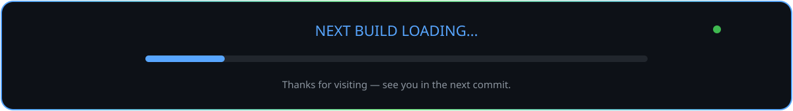

</p>


</p>

<p align="center">

<i>
Thanks for stopping by.
Now go build something awesome.
</i>

</p>
